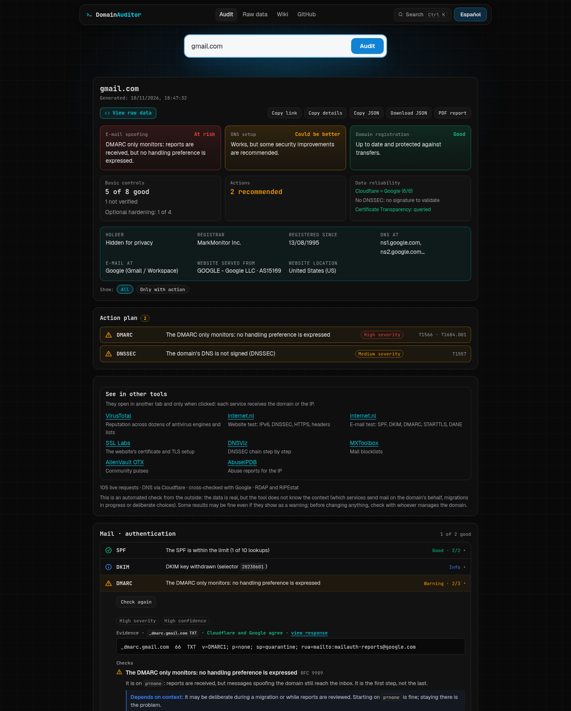

# Domain Auditor

**Audit a domain or an IP from your browser: DNS records, SPF, DKIM, DMARC, DNSSEC, MTA-STS and RDAP.**
No server, no sign-up, nothing stored. Also as a **desktop app for Windows and Linux** that adds HTTPS, TLS, security headers, security.txt and the full MTA-STS policy.

**→ [audit.felixllorente.com](https://audit.felixllorente.com)**

[Español](#español) · [English](#english)



---

## Español

### El problema

Muchas pymes no saben si su dominio se puede suplantar por correo, si su DNS está
bien montado o cuándo caduca. Comprobarlo exige saber qué registros mirar y cómo
interpretarlos. Domain Auditor lo hace en unos segundos y explica cada fallo y
cómo arreglarlo.

### Qué comprueba

Lo primero que muestra es **quién es**: para una IP, su nombre inverso, el titular
del bloque, la red que la anuncia y el país del registro (8.8.8.8 → `dns.google`,
Google LLC, AS15169); para un dominio, su titular (si el registrador lo publica),
el registrador, la antigüedad y dónde están su DNS, su correo y su web. Todo sale
de consultas en vivo (PTR, RDAP, RIPEstat), sin listas fijas.

| Área | Comprobaciones |
| --- | --- |
| **Correo** | MX, null MX y proveedor · SPF (sintaxis, `all`, límite de 10 consultas DNS con includes anidados, bucles) · DMARC según el RFC 9989 (política, `sp`, modo prueba `t`, etiquetas eliminadas, informes, DNS Tree Walk en subdominios) · DKIM (selectores comunes, tamaño de la clave RSA, claves revocadas, modo prueba) · MTA-STS · TLS-RPT · DANE · BIMI · contexto: si el dominio usa correo o no |
| **DNS** | NS, proveedor y redes · SOA · A/AAAA e IPv6 · comodín · CAA (con herencia) · DNSSEC (DS, validación y algoritmos según el RFC 9904) · contraste Cloudflare/Google |
| **Superficie de ataque** | Subdominios en Certificate Transparency (crt.sh) · CNAME colgantes (*subdomain takeover*) · certificados en vigor frente al CAA · web, `www` y proxy/CDN · integraciones de terceros (TXT de verificación e `include:` del SPF) |
| **Web** (app de escritorio) | HTTP → HTTPS y HSTS (RFC 6797) · certificado (confianza, nombre, caducidad) y TLS 1.0/1.1 aceptados (RFC 8996) · cabeceras de seguridad (clickjacking, `nosniff`, CSP, `Referrer-Policy`, versión del servidor) · security.txt (RFC 9116) · política MTA-STS completa (RFC 8461) |
| **Registro** | Registrador, alta, caducidad y bloqueo de transferencia (RDAP) |
| **IP** | DNS inverso (PTR) y FCrDNS · AS y prefijo anunciado · titular, red y país (RDAP) · rangos privados y reservados |

El informe se organiza en **controles** agrupados por áreas (correo, DNS,
superficie de ataque, registro). Cada control muestra primero la **evidencia**
(los registros tal como llegan y si Cloudflare y Google coinciden), después las
**comprobaciones**, el **riesgo** (con las técnicas de MITRE ATT&CK relacionadas
cuando la relación es directa) y la **acción**, con el registro exacto listo para
copiar. Cada control tiene un estado (bien, aviso, fallo, info, no aplica, sin
verificar), una severidad y un nivel de confianza. Arriba, 8 controles básicos
iguales para todos los dominios (la superficie de ataque es informativa y no
puntúa), un plan de acción ordenado por severidad y la fiabilidad de los datos. Las recomendaciones dependen del contexto: a un dominio
sin correo no se le pide DKIM y se le propone DMARC en `reject` directamente.
Cada control se puede **volver a comprobar** tras un cambio (con el TTL que falta si aún no se ve), al repetir un dominio se muestran los **cambios desde la última auditoría** (guardada sólo en el navegador) y el informe se puede guardar en **PDF**. **Ctrl+K** busca en el informe y en la wiki; el informe se puede compartir con un
enlace (`?q=ejemplo.com`), copiar en Markdown o descargar en JSON.

**Datos en crudo**: cada petición (DoH de Cloudflare y Google, RDAP, RIPEstat, crt.sh) se
guarda con su respuesta original. La pestaña «Datos en crudo» las muestra con su
URL y el comando `curl` para repetirlas, y compara los registros clave entre
Cloudflare y Google. Así se puede comprobar el informe contra la fuente.

La **[wiki](https://audit.felixllorente.com/wiki/)** explica qué es cada registro,
qué se comprueba y enlaza a la documentación oficial (RFC, IANA, ICANN, RIPE NCC).

### Cómo funciona

Todo ocurre en tu navegador. La página es estática, sin servidor propio, y
consulta directamente servicios públicos que permiten CORS:

- **DNS sobre HTTPS** de [Cloudflare](https://developers.cloudflare.com/1.1.1.1/encryption/dns-over-https/make-api-requests/dns-json/), con [Google](https://developers.google.com/speed/public-dns/docs/doh/json) como respaldo.
- **RDAP** (el sustituto de WHOIS) del propio registro de cada TLD o RIR, localizado con el [índice de IANA](https://data.iana.org/rdap/) (RFC 9224); [rdap.org](https://rdap.org) sólo si el índice no responde.
- **[RIPEstat](https://stat.ripe.net/docs/data-api/api-endpoints/prefix-overview)** para el AS que anuncia cada IP.
- **[crt.sh](https://crt.sh/)** (Certificate Transparency, RFC 6962) para los subdominios y certificados emitidos, con [Cert Spotter](https://sslmate.com/certspotter/api/) como respaldo.
- **[Shodan InternetDB](https://internetdb.shodan.io/)** y **[AlienVault OTX](https://otx.alienvault.com/)** como contexto de exposición y reputación, siempre informativo y atribuido a su fuente.
- Enlaces a **VirusTotal, internet.nl, SSL Labs, DNSViz, MXToolbox, AbuseIPDB y Shodan** para el mismo dominio o IP; sólo se abren si se pulsan.
- **[MITRE ATT&CK®](https://attack.mitre.org/)** para las técnicas relacionadas. © 2026 The MITRE Corporation. This work is reproduced and distributed with the permission of The MITRE Corporation.

```
src/core/          lógica de análisis, sin DOM (probada con Vitest)
src/messages/      textos de cada resultado, en español e inglés
src/main.ts        página de auditoría
src/ui/            cabecera, buscador y datos en crudo
src/wiki/          contenido y página de la wiki
tests/             pruebas con un resolvedor DNS falso
```

La explicación completa de cómo está hecho (cada módulo, qué norma sigue, las
decisiones de diseño y sus límites) está en
**[docs/como-esta-hecho.md](docs/como-esta-hecho.md)**.

### App de escritorio (Windows y Linux)

La misma herramienta como aplicación (Electron), que además hace lo que un
navegador no puede: se conecta a la web del dominio como lo haría un navegador y
lee sus cabeceras, su certificado y su TLS, el `security.txt` y la política
MTA-STS. Nunca se conecta a direcciones privadas de tu red, y el informe se guarda
directamente en PDF.

```bash
pnpm desktop      # compila y abre la app
pnpm dist:linux   # release/: AppImage, .rpm (Fedora) y .tar.gz
pnpm dist:win     # release/: .zip para Windows (el instalador se genera en CI, en Windows)
```

Guía de instalación y uso: **[docs/escritorio.md](docs/escritorio.md)**.

### Uso en local

Requisitos: Node.js 22 y pnpm 10.

```bash
pnpm install
pnpm dev      # http://localhost:5173
pnpm check    # lint, tipos, pruebas y compilación
```

Validación en vivo contra dominios reales, con cada afirmación contrastada con fuentes independientes (ver [docs/validacion.md](docs/validacion.md)):

```bash
pnpm validate
```

### Límites

- **DKIM** no se puede enumerar por DNS: se prueban 37 selectores habituales y se
  puede escribir uno concreto (el `s=` de la cabecera `DKIM-Signature`).
- **Cabeceras HTTP y TLS** no se pueden leer desde un navegador (CORS y falta de
  acceso a TLS): las comprueba la app de escritorio, en la página de inicio.
- **RDAP**: algunos registros nacionales, como `.es`, todavía no lo ofrecen.
- **MTA-STS**: en la web se comprueba el registro y que exista su servidor; el
  contenido de la política (bloqueado por CORS) lo lee la app de escritorio.
- **DNSSEC**: no se validan las firmas por cuenta propia; se exige que las validen
  dos resolvedores independientes (Cloudflare y Google).
- **SPF**: las macros (`%{i}`…) dependen del remitente y no se evalúan.
- **Contexto**: es una revisión automática desde fuera. Los datos son reales, pero
  algunos avisos pueden ser decisiones correctas en su caso; cada resultado lo
  explica en «Depende del contexto».

---

## English

### The problem

Many small businesses do not know whether their domain can be spoofed by e-mail,
whether their DNS is set up properly or when it expires. Checking it means
knowing which records to look at and how to read them. Domain Auditor does it in
seconds and explains every issue and how to fix it.

### What it checks

The first thing it shows is **who it is**: for an IP, its reverse name, block
holder, announcing network and registry country (8.8.8.8 → `dns.google`, Google
LLC, AS15169); for a domain, its holder (if the registrar publishes it), registrar,
age and where its DNS, mail and website live. Everything comes from live queries
(PTR, RDAP, RIPEstat), with no fixed lists.

| Area | Checks |
| --- | --- |
| **E-mail** | MX, null MX and provider · SPF (syntax, `all`, 10 DNS-lookup limit with nested includes, loops) · DMARC per RFC 9989 (policy, `sp`, `t` test mode, removed tags, reports, DNS Tree Walk for subdomains) · DKIM (common selectors, RSA key size, revoked keys, test mode) · MTA-STS · TLS-RPT · DANE · BIMI · context: whether the domain uses mail |
| **DNS** | NS, provider and networks · SOA · A/AAAA and IPv6 · wildcard · CAA (with inheritance) · DNSSEC (DS, validation and algorithms per RFC 9904) · Cloudflare/Google cross-check |
| **Attack surface** | Subdomains in Certificate Transparency (crt.sh) · dangling CNAMEs (subdomain takeover) · certificates in force against CAA · website, `www` and proxy/CDN · third-party integrations (TXT verifications and SPF `include:`) |
| **Website** (desktop app) | HTTP → HTTPS and HSTS (RFC 6797) · certificate (trust, name, expiry) and TLS 1.0/1.1 accepted (RFC 8996) · security headers (clickjacking, `nosniff`, CSP, `Referrer-Policy`, server version) · security.txt (RFC 9116) · full MTA-STS policy (RFC 8461) |
| **Registration** | Registrar, creation, expiry and transfer lock (RDAP) |
| **IP** | Reverse DNS (PTR) and FCrDNS · AS and announced prefix · holder, network and country (RDAP) · private and reserved ranges |

The report is organised in **controls** grouped by area (mail, DNS, attack
surface, registration). Each control shows the **evidence** first (records as
received and whether Cloudflare and Google agree), then the **checks**, the
**risk** (with related MITRE ATT&CK techniques where the link is direct) and the
**action**, with the exact record ready to copy. Each control has a state (good,
warning, failure, info, not applicable, not verified), a severity and a
confidence level. At the top: 8 basic controls, the same for every domain (the
attack surface is informative and not scored), an action plan ordered by
severity and the reliability of the data.
Recommendations depend on context: a domain without mail is not asked for DKIM
and is offered DMARC at `reject` straight away. Each control can be **checked again** after a change (with the TTL left if it does not show yet), auditing a domain again shows the **changes since the last audit** (kept only in the browser) and the report can be saved as a **PDF**. **Ctrl+K** searches the report
and the wiki; reports can be shared as a link (`?q=example.com`), copied as
Markdown or downloaded as JSON.

**Raw data**: every request (Cloudflare and Google DoH, RDAP, RIPEstat, crt.sh) is kept
with its original response. The "Raw data" tab lists them with their URL and the
`curl` command to repeat them, and compares key records between Cloudflare and
Google, so the report can be checked against the source.

The **[wiki](https://audit.felixllorente.com/wiki/)** explains every record and
check, with links to the official documentation (RFCs, IANA, ICANN, RIPE NCC).

### How it works

Everything runs in your browser. The page is static, with no server of its own,
and talks directly to public services that allow CORS:

- **DNS over HTTPS** from [Cloudflare](https://developers.cloudflare.com/1.1.1.1/encryption/dns-over-https/make-api-requests/dns-json/), with [Google](https://developers.google.com/speed/public-dns/docs/doh/json) as a fallback.
- **RDAP** (the WHOIS replacement) from each TLD registry or RIR itself, found through [IANA's index](https://data.iana.org/rdap/) (RFC 9224); [rdap.org](https://rdap.org) only if the index does not answer.
- **[RIPEstat](https://stat.ripe.net/docs/data-api/api-endpoints/prefix-overview)** for the AS announcing each IP.
- **[crt.sh](https://crt.sh/)** (Certificate Transparency, RFC 6962) for subdomains and issued certificates, with [Cert Spotter](https://sslmate.com/certspotter/api/) as a fallback.
- **[Shodan InternetDB](https://internetdb.shodan.io/)** and **[AlienVault OTX](https://otx.alienvault.com/)** as exposure and reputation context, always informative and attributed to its source.
- Links to **VirusTotal, internet.nl, SSL Labs, DNSViz, MXToolbox, AbuseIPDB and Shodan** for the same domain or IP; they only open when clicked.
- **[MITRE ATT&CK®](https://attack.mitre.org/)** for related techniques. © 2026 The MITRE Corporation. This work is reproduced and distributed with the permission of The MITRE Corporation.

### Desktop app (Windows and Linux)

The same tool as an application (Electron) that also does what a browser
cannot: it connects to the domain's website as a browser would and reads its
headers, certificate and TLS, its `security.txt` and the MTA-STS policy. It never
connects to private addresses of your network, and the report is saved straight
to PDF.

```bash
pnpm desktop      # build and open the app
pnpm dist:linux   # release/: AppImage, .rpm (Fedora) and .tar.gz
pnpm dist:win     # release/: .zip for Windows (the installer is built in CI, on Windows)
```

Install and usage guide (Spanish): **[docs/escritorio.md](docs/escritorio.md)**.

### Running locally

Requirements: Node.js 22 and pnpm 10.

```bash
pnpm install
pnpm dev      # http://localhost:5173
pnpm check    # lint, types, tests and build
```

Live validation against real domains, with every claim checked against independent sources (see [docs/validacion.md](docs/validacion.md)):

```bash
pnpm validate
```

### Limits

- **DKIM** selectors cannot be listed through DNS: 37 common ones are probed and a
  specific one can be typed in (the `s=` of the `DKIM-Signature` header).
- **HTTP headers and TLS** cannot be read from a browser (CORS, no TLS access):
  the desktop app checks them, on the home page.
- **RDAP**: some country registries, such as `.es`, do not offer it yet.
- **MTA-STS**: on the web the record and its server are checked; the policy
  content (blocked by CORS) is read by the desktop app.
- **DNSSEC**: signatures are not validated locally; two independent resolvers
  (Cloudflare and Google) must both validate them.
- **SPF**: macros (`%{i}`…) depend on the sender and are not evaluated.
- **Context**: this is an automated outside check. The data is real, but some
  warnings may be correct choices in a given case; each result explains it under
  "Depends on context".

The full explanation of how it is built is in
**[docs/como-esta-hecho.md](docs/como-esta-hecho.md)** (in Spanish).

---

MIT © [Félix Llorente](https://felixllorente.com)
